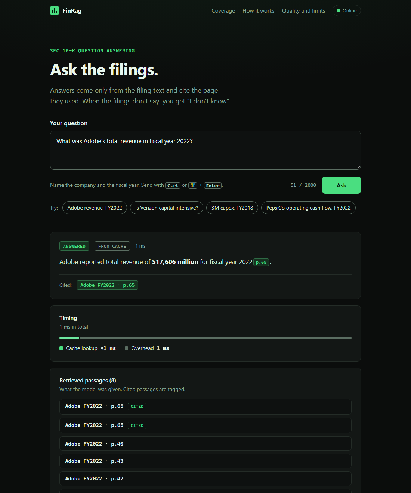
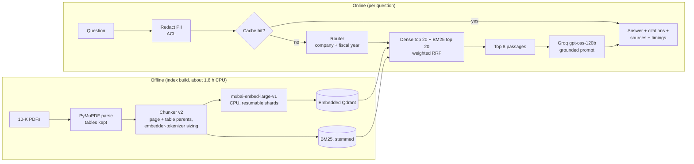
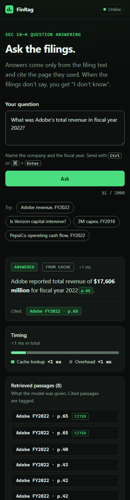

# FinRag

Retrieval-augmented question answering over SEC 10-K filings. Ask a question about a company's annual report and get
an answer that cites the page it came from, or "I don't know" when the filing does not say.

<p align="center">
  
</p>

FinRag runs on free tiers only: local CPU embeddings, an embedded vector store, and a free Groq key for the language
model. It covers a fixed subset of 22 annual reports from 10 companies (a slice of the
[FinanceBench](https://github.com/patronus-ai/financebench) benchmark), and every design decision, including the ones
that did not work, is logged with its measurements in [`docs/experiments.md`](docs/experiments.md).

**Status.** Finished and tested; runs locally and in Docker. It is **not deployed**: no free host fits an app that needs
about 2 GB of RAM (Hugging Face Docker Spaces turned out to be a paid feature), and a paid host was ruled out. What was checked
and what hosting it would take are in [`docs/DEPLOYMENT.md`](docs/DEPLOYMENT.md).

## Contents

[Results](#results) · [Architecture](#architecture) · [Quick start](#quick-start) · [API](#api) ·
[Configuration](#configuration) · [Security and abuse protection](#security-and-abuse-protection) ·
[Evaluation](#evaluation) · [Limitations](#limitations) · [Repository layout](#repository-layout)

## Results

Numbers exactly as measured on 29 questions per split. One question moves a score by 0.034.

| Split | Passages to the LLM | Recall@5 | MRR | Accuracy | Faithfulness | "I don't know" | p50 / p95 latency |
|---|---|---|---|---|---|---|---|
| **Test** (held out, run once) | 5 | 0.552 (16/29) | 0.324 | 0.414 (12/29) | 0.842 (n=19) | 10 | 2.6 s / 10.1 s |
| Dev (used for tuning) | 8 (the shipped setting) | 0.586 (17/29) | 0.452 | 0.690 (20/29) | 0.940 (n=25) | 4 | 2.1 s* |

\* over the 10 questions that were not already cached.

**Read this before trusting the table.** The test split was run once, before the final setting (8 passages) was chosen,
so the test row describes an earlier configuration. The shipped setting was only evaluated on dev, the set everything
was tuned on, so expect real-world accuracy nearer the test column. Against the project's targets (recall@5 >= 0.80,
accuracy 60-75%, faithfulness >= 0.90) the held-out numbers fall short on all three; only p50 latency under 4 s is met.

- *Recall@5* is page-level: 1 if any of the top 5 retrieved pages is a gold page. *MRR* is the reciprocal rank of the
  first gold page. *Accuracy* is an LLM judge comparing the answer with the gold answer. *Faithfulness* is the share of
  claims in an answer supported by the retrieved passages, over answered questions only.
- The same model family answers and judges. There is no human review.

### What each change did (dev split, one run each)

| # | Change | Recall@5 | MRR | Accuracy | Faithfulness | Decision |
|---|---|---|---|---|---|---|
| 0 | Baseline: dense + BM25 + RRF, no filter | 0.172 | 0.108 | 0.207 | 0.947 (n=10) | baseline |
| 1 | Company and fiscal-year filter (rule-based router) | 0.207 | 0.124 | 0.448 | 0.900 (n=17) | keep |
| 2 | Cross-encoder rerank | 0.172 | 0.099 | 0.310 | 0.905 (n=13) | reverted |
| 8 | Router reads "FY22" and picks the latest year | 0.310 | 0.153 | 0.517 | 0.904 (n=19) | keep |
| 9 | Drop chunks under 15 tokens at retrieval | 0.345 | 0.196 | 0.517 | 0.909 (n=19) | keep |
| 10 | Index v2: tokenizer-aware chunking, table row groups, rich prefix, `mxbai-embed-large-v1`, stemmed BM25 | 0.517 | 0.411 | 0.552 | 0.908 (n=21) | keep |
| 11 | Query instruction prefix (offline) | 0.517 | 0.379 | n/a | n/a | rejected |
| 12 | Weighted fusion, BM25 weight 1.0 to 0.25 | 0.586 | 0.452 | 0.586 | 0.930 (n=22) | keep |
| 13 | Whole-table expansion for generation | 0.586 | 0.452 | 0.586 | 0.930 | rejected (no change) |
| 14 | Numeric-reasoning prompt | 0.586 | 0.452 | 0.552 | 0.846 | reverted |
| 15 | Four other rerankers (offline) | best 0.621 | all < 0.452 | n/a | n/a | rejected |
| 16 | Passages given to the LLM: 5 to 8 | 0.586 | 0.452 | **0.690** | **0.940 (n=25)** | **keep (shipped)** |

Experiments 3 to 7 were pilots or repeats of the rows above. Ties of one to two questions are within run-to-run noise
(an unchanged configuration swapped one question each way once); the log records which gains were more than that.
The citation parser was also fixed after the test run: the model often writes `【doc p.N】` with full-width brackets and
the old parser found a citation in only 72 of 153 saved answers that named a document, the new one in 151
(`docs/experiments.md`, experiment 19). Metrics are unaffected, because the answer text is never rewritten.

## Architecture



- **Router.** A rule-based detector finds the company and fiscal year in the question and restricts retrieval to that
  filing. A question that names no known company gets "I don't know" with no model call.
- **Retrieval.** Dense and BM25 candidates are fused with weighted reciprocal-rank fusion (1.0 dense : 0.25 BM25).
  Chunks are sized with the embedding model's own tokenizer, so a table is never silently truncated; large tables are
  split into row groups with repeated headers. A cross-encoder reranker exists and is switched off: it lowered MRR.
- **Generation.** The model sees only the retrieved passages and must cite `[doc_id p.N]` or answer exactly
  `I don't know`. All LLM calls go through one client with a disk cache, key rotation, retries, backoff and per-key daily
  request and token budgets (it stops at 80%).
- **Index safety.** Each index carries a manifest (model, chunking and tokenizer parameters). Loading refuses a mismatch,
  and a protected version (v1, the rollback) cannot be rebuilt.

Full design, schemas and every default: [`docs/ARCHITECTURE.md`](docs/ARCHITECTURE.md).

## Quick start

Requirements: Python 3.13 (the tests run on 3.13.3), about 1 GB of disk for the embedding model, Node 20+ only if you
run the frontend tests. Windows shown first; on Linux or macOS use `source .venv/bin/activate`.

```bash
python -m venv .venv && .venv\Scripts\activate
pip install -r requirements.txt
cp .env.example .env        # (Windows: copy) then add your Groq keys: three free accounts, or one
pytest                      # Python suite; no API keys needed
```

The API needs the prebuilt index in `.cache/index/v2`. It is not in git. Build it once (offline, resumable):

```bash
python -m src.jobs.prepare_data      # download the 10-K PDFs and questions, freeze the dev/test split
python -m src.jobs.index_corpus      # parse, chunk, embed, build Qdrant + BM25 (about 1.6 h on a laptop CPU)
```

### Run it and try it

```bash
python main.py                 # then open http://localhost:8000
```

That is the whole app: the API serves the web UI at `/` (same origin, so no CORS setup), and `/health` and `/query` next to
it. Interactive API docs are at `/docs`. Needs `.env` with at least one Groq key and the built index (above).

```bash
docker compose up --build      # the same app in a container: http://localhost:8000
```

The image (python:3.13-slim, about 3.3 GB) bakes in the v2 index, the embedding model and the UI, so it starts offline. Keys come
from `.env` at run time and are never in the image. `./.cache/llm` (LLM cache and per-key budget counters) and `./.cache/state`
(semantic cache and the daily-cap counter) are mounted, so restarts keep them.

What to try in the UI:

- Click an example question, or ask one such as *What was Adobe's total revenue in fiscal year 2022?*. The first question after
  starting is slower (about 12 s: the embedding model loads).
- Click a citation chip: the retrieved passage it came from opens below. Ask something outside the 10 covered companies and
  you get "I don't know" with no model call.
- Ask 6 questions within a minute to see the rate limit (5 per minute), with a countdown.
- Costs: a new question uses one Groq call (about 1.3k to 2.4k tokens); a repeated question is served from the cache for free.

### Tests

```bash
pytest                                 # Python: retrieval, cache, ACL, rate limit, API, export, eval metrics
cd frontend && npm test                # Node 20+, built-in runner: answer rendering (XSS cases), citations, errors
python -m src.jobs.eval_nightly --split dev --limit 5   # smoke eval (a few LLM calls per question; cached after the first run)
```

## API

| Route | Description |
|---|---|
| `GET /health` | `{"status": "ok"}`. Instant, loads no models, never rate limited. |
| `POST /query` | Body `{"question": "...", "user": "optional"}`. Returns a `QueryResult`. |

```bash
curl -X POST http://localhost:8000/query -H "Content-Type: application/json" \
     -d '{"question": "What was Adobe total revenue in fiscal year 2022?"}'
```

```json
{
  "answer": "Adobe reported total revenue of **$17,606 million** for fiscal year 2022 [ADOBE_2022_10K p.65].",
  "citations": [{"doc_id": "ADOBE_2022_10K", "page": 65}],
  "contexts": ["...8 retrieved passages, as text..."],
  "sources": [{"doc_id": "ADOBE_2022_10K", "page": 65}, "...one per context, same order..."],
  "latency_ms": {"retrieve": 311.0, "rerank": 0.0, "llm": 1180.0, "total": 1500.0}
}
```

`citations` are the pages the answer cites, restricted to pages that were retrieved. A cached answer has
`latency_ms: {"cache": ..., "total": ...}`. The numbers in the example are illustrative.

| Status | Meaning |
|---|---|
| 401 | `api.require_api_key` is on and `X-API-Key` is missing or wrong |
| 422 | Blank question, or longer than `api.max_question_chars` (2000) |
| 429 | Per-IP rate limit; `Retry-After` gives the wait in seconds |
| 503 | Daily global cap reached, the LLM quota is nearly used, or the LLM provider is down; `Retry-After` is set for the cap |

## Configuration

Everything lives in [`config.yaml`](config.yaml); there are no magic numbers in the code. Secrets come from the
environment ([`.env.example`](.env.example)). The ones you are most likely to change:

| Setting | Default | Effect |
|---|---|---|
| `rerank.top_n` | 8 | Passages given to the LLM (experiment 16) |
| `retrieval.bm25_weight` | 0.25 | Weight of keyword search in the fusion (experiment 12) |
| `index.version` | v2 | Which prebuilt index to load; `config.v1.yaml` selects the v1 rollback |
| `api.rate_limit` | 5 / minute, 40 / day per IP | Per-client sliding windows |
| `api.daily_global_cap` | 180 | Accepted questions per UTC day over all clients |
| `api.cors_origins`, `FINRAG_CORS_ORIGINS` | none | Browser origins allowed to call the API |
| `api.require_api_key`, `FINRAG_API_KEY` | off | Private mode, or an owner key that skips the per-IP limit |
| `api.trusted_proxy_hops` | 1 | Proxies in front of the app, used to find the real client address |
| `cache.threshold` | 0.95 | Similarity needed for a semantic cache hit |
| `llm.primary.daily_token_budget` | 200000 | Per-key daily token budget (client stops at 80%) |

The semantic cache is keyed on every setting that shapes an answer (index, retrieval, rerank, generation, model), so a
config or parser change never serves an old answer; bump `cache.version` when the result format changes.

## Security and abuse protection

A public demo spends a shared free quota, so the API defends it. On `POST /query`, in this order:

1. **API key** (optional). `require_api_key: true` closes the API to callers without the key (fails closed if no key is set).
2. **Per-IP limit.** 5 per minute and 40 per day per client; a valid owner key skips it. Blocked requests cost nothing
   and do not extend the block. The client address is the entry `trusted_proxy_hops` from the right of `X-Forwarded-For`,
   because entries added by the client on the left can be forged.
3. **Daily global cap.** 180 accepted calls per UTC day over all clients, persisted so a restart does not reset it. The
   cap is sized so that it cannot outspend the usable Groq tokens (see [`docs/DEPLOYMENT.md`](docs/DEPLOYMENT.md)).

Also: every response carries security headers and a strict Content-Security-Policy (no inline script or style, nothing from other
origins), CORS is off unless origins are configured (and it stays readable on 429/503), invalid
requests count against the limit, the question is redacted of e-mail addresses and phone numbers before it reaches logs,
cache, retriever or LLM, and the web UI treats model output as untrusted (everything is escaped; strict CSP; no inline
scripts or styles). Request logs record a salted hash of the client, status and timings, never the address or the question;
the container runs with the web server's own access log off, because that log prints client addresses.

What this does **not** do: a determined attacker with many IP addresses is bounded only by the daily cap, not by the
per-IP limit. Any key placed in browser JavaScript is public, so for the public site the protection is the limits and the
cap, not a secret. The `user` field of the request selects an ACL and is trusted: do not use ACLs as an access boundary on
a public endpoint.

## Evaluation

- Data: FinanceBench open-source questions for 10 companies; fixed split, 29 dev and 29 test (seed 42). The test split is
  refused by the eval job unless `--final` is passed and was used once.
- `python -m src.jobs.eval_nightly --split dev` runs the pipeline and the two judges; results go to `data/eval/runs/`.
  A full run with every answer regenerated costs about 70 to 90 requests and 70k to 110k tokens. Cached runs cost nothing.
- Offline tools that make no LLM calls: `compare_indexes`, `fusion_sweep`, `rerank_dev`, `pilot_bakeoff`, `bench_embed`.

## Limitations

- **Small sample.** 22 filings, 10 companies, 29 questions per split: results do not generalise to all filings, and the
  shipped setting is only validated on the split it was tuned on.
- **Roughly half the answers are wrong.** On the held-out test, 17 of 29 were judged wrong or "I don't know". Treat an
  answer as a pointer to the right passage, not a verified figure; the UI is built around that (citations open the passage).
- **LLM-as-judge.** Accuracy and faithfulness are scored by the model family that answers; no human review.
- **Multi-page questions.** Ratios that need two statements fail when only one page is retrieved; page-level recall hides it.
- **Text and tables only.** Scanned or image-only pages are skipped (no OCR); charts are not read.
- **Free-tier limits.** Groq allows 200,000 tokens per day per key; the system stops at 80% and the public demo has a hard
  daily cap. A free host sleeps when idle, so the first request after a pause is slow; the UI warns and polls `/health`.
- **Untested ideas.** A statement-type boost, ratio-term expansion, multi-page diversification of the context and
  sentence-aware windowing are recorded in `docs/experiments.md` but were not tried.

## Repository layout

```
config.yaml            all settings              main.py            API entry point
src/ingestion, chunking, embeddings, vector_db, lexical     offline: parse, chunk, embed, index
src/retrieval, query, rerank, generation, prompts, llm      online: route, retrieve, answer
src/cache, security, observability, api                     semantic cache, ACL + rate limits, tracing, FastAPI
src/pipelines, jobs, eval                                   orchestration, CLI jobs, metrics
frontend/              web UI: plain HTML, CSS and JS, no framework, no build step; served by the API
tests/                 Python tests          frontend/test   Node tests
docs/                  ARCHITECTURE.md, DEPLOYMENT.md, experiments.md, plan and prompts
Dockerfile, docker-compose.yaml, .env.example
```

<p align="center"></p>

## Acknowledgements and licence

Questions and gold answers come from [FinanceBench](https://github.com/patronus-ai/financebench) (Patronus AI); the filings
are public SEC documents. This project is not affiliated with the companies, Patronus AI or the SEC and is not financial
advice. Released under the [MIT licence](LICENSE).
